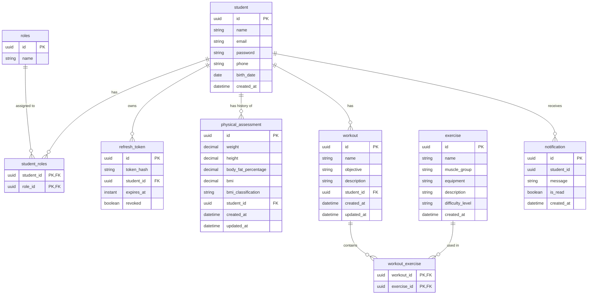

<div align="center">

# 🌱 SpringFit

*A modern REST API for managing gyms, students, and workouts with Spring Boot.*


---

📃 [About](#-about)&nbsp;&nbsp;•&nbsp;&nbsp;
🛠️ [Technologies](#-technologies)&nbsp;&nbsp;•&nbsp;&nbsp;
✨ [Features](#-features)&nbsp;&nbsp;•&nbsp;&nbsp;
🚀 [Getting Started](#-getting-started)&nbsp;&nbsp;•&nbsp;&nbsp;
🧪 [Tests](#-tests)&nbsp;&nbsp;•&nbsp;&nbsp;
⚙️ [CI/CD](#️-cicd)&nbsp;&nbsp;•&nbsp;&nbsp;
📖 [API Documentation](#-api-documentation)

</div>

---

## 📃 About

**SpringFit** is a REST API for gym management built with **Spring Boot** and **Spring Security**. It allows you to
register students, create personalized workouts, manage exercises by muscle group, and record physical assessments.

The API features **JWT** authentication with **refresh token rotation**, role-based access control, **rate limiting**,
**event-driven notifications** powered by **RabbitMQ**, a **Docker** setup for the whole stack, automated tests, a
**GitHub Actions** CI pipeline, and interactive documentation powered by **Swagger**.

---

## 🛠️ Technologies

- ☕ **[Java 17](https://www.oracle.com/java/)** — Main programming language.
- 🌱 **[Spring Boot 4](https://spring.io/projects/spring-boot)** — Framework for building modern Java applications.
- 🔐 **[Spring Security](https://spring.io/projects/spring-security)** — Authentication and access control.
- 🗃️ **[Spring Data JPA](https://spring.io/projects/spring-data-jpa)** — Data access abstraction with Hibernate.
- 🐇 **[RabbitMQ](https://www.rabbitmq.com/) + [Spring AMQP](https://spring.io/projects/spring-amqp)** — Asynchronous
  messaging and event-driven notifications.
- 🐬 **[MySQL 8](https://www.mysql.com/)** — Relational database used in production.
- 🗄️ **[H2](https://www.h2database.com/)** — In-memory database for local development and automated tests.
- 🔑 **[JJWT](https://github.com/jwtk/jjwt)** — JWT token generation and validation.
- 🪣 **[Bucket4j](https://github.com/bucket4j/bucket4j) + [Caffeine](https://github.com/ben-manes/caffeine)** — Rate
  limiting per client IP.
- 📖 **[SpringDoc OpenAPI](https://springdoc.org/)** — Interactive API documentation via Swagger UI.
- 🏗️ **[Lombok](https://projectlombok.org/)** — Boilerplate reduction through code generation.
- ✅ **[Bean Validation](https://beanvalidation.org/)** — Input data validation.
- 📦 **[Maven](https://maven.apache.org/)** — Dependency management and build automation (via Maven Wrapper).
- 🐳 **[Docker](https://www.docker.com/) + [Docker Compose](https://docs.docker.com/compose/)** — Multi-stage image for
  the API, plus MySQL and RabbitMQ containers for a reproducible environment.
- ⚙️ **[GitHub Actions](https://github.com/features/actions)** — Continuous integration, PR validation and automatic
  labeling.
- 🤖 **[Dependabot](https://docs.github.com/en/code-security/dependabot)** — Automated dependency updates.
- 🧪 **[JUnit 5](https://junit.org/junit5/)** — Test framework.
- 🎭 **[Mockito](https://site.mockito.org/)** — Mocking dependencies in unit tests.
- 🔎 **[AssertJ](https://assertj.github.io/doc/)** — Fluent assertions.
- 🌿 **[Spring Boot Test](https://docs.spring.io/spring-boot/reference/testing/index.html)** — Application context tests
  with a dedicated `test` profile.

---

## ✨ Features

### 🔐 Authentication & Security

- [x] JWT authentication (register and login)
- [x] Refresh tokens with **rotation** (each refresh issues a new token and revokes the old one)
- [x] **Reuse detection** — using an already revoked refresh token revokes all tokens of that user
- [x] Refresh tokens stored as **SHA-256 hashes** (the raw token is never persisted)
- [x] Logout endpoint (revokes the refresh token)
- [x] Scheduled job that cleans up expired refresh tokens daily at 03:00
- [x] Passwords hashed with BCrypt, with validation rules (minimum length, letter + digit, max 72 bytes)
- [x] Role-based access control (`ADMIN` and `STUDENT`)
- [x] Ownership checks with `@PreAuthorize` (students can only access their own data)
- [x] **Rate limiting** per client IP: stricter limit on `/v1/auth/**`, general limit on the rest of the API
- [x] Standard `429 Too Many Requests` responses with `Retry-After`, and `X-Rate-Limit-Remaining` on successful calls

### 🏋️ Gym Management

- [x] Student registration, profile update, lookup and removal (cascades to workouts and assessments)
- [x] Personalized workouts per student: create, update, delete, and list
- [x] Add and remove exercises from a workout (a workout must keep at least one exercise)
- [x] Exercise management by muscle group, with default difficulty level
- [x] Protection against deleting exercises that belong to workouts
- [x] Physical assessment registration (admin only) with automatic **BMI** calculation and classification
- [x] Assessment listing with projections and **pagination**
- [x] Students can only view their own physical assessments

### 📨 Event-Driven Notifications

- [x] `PhysicalAssessmentCreatedEvent` published to RabbitMQ when an assessment is created
- [x] Listener that turns each event into a student notification
- [x] Notification listing, "mark as read" and "mark all as read" endpoints
- [x] Retry with exponential backoff and a **Dead Letter Queue** for failed messages

### 🐳 Containerization

- [x] Multi-stage **Dockerfile** (JDK build stage, JRE runtime stage) producing a small runtime image
- [x] Application runs as a **non-root** user
- [x] Container memory limited by the JVM with `MaxRAMPercentage=75`
- [x] **Docker Compose** orchestrates the API, MySQL and RabbitMQ, with health checks and startup ordering
- [x] `.dockerignore` keeps build artifacts and local IDE/secret files out of the image

### 🧰 Quality & Developer Experience

- [x] Global exception handler with standardized error responses
- [x] Detailed validation error responses (field + message)
- [x] Data seeder with an admin, a student and sample exercises
- [x] Unit tests for the service layer (exercises, workouts, notifications) and application context test
- [x] CI pipeline with GitHub Actions
- [x] Semantic PR titles and automatic PR labeling
- [x] Interactive documentation with Swagger UI and Bearer authentication support

---

## 🏛️ Architecture

### 📁 Project Structure

```text
.
├── Dockerfile          # Multi-stage image for the API
├── docker-compose.yml  # API + MySQL + RabbitMQ
├── .env.example        # Environment variables template
└── src/main/java/br/com/joschonarth/springfit
    ├── config/         # Security, JWT, rate limiting, OpenAPI, RabbitMQ and data seeder
    ├── controller/     # REST controllers
    ├── service/        # Business logic
    ├── database/
    │   ├── model/      # JPA entities
    │   └── repository/ # Spring Data repositories
    ├── dto/
    │   ├── request/    # Request bodies
    │   ├── response/   # Response bodies
    │   ├── projection/ # Interface-based projections
    │   └── event/      # Messaging events
    ├── listener/       # RabbitMQ listeners
    ├── job/            # Scheduled jobs
    ├── enums/          # Domain enums
    ├── exception/      # Custom exceptions and error responses
    ├── handler/        # Global exception handler
    └── validation/     # Custom validation annotations
```

---

## 🗄️ Database Diagram



---

## 🚀 Getting Started

There are two ways to run SpringFit: the **full stack with Docker** (recommended) or **locally with Maven**.

### 📋 Prerequisites

- 🐳 [Docker](https://www.docker.com/) with Docker Compose (recommended path)
- ☕ [Java 17+](https://www.oracle.com/java/) (local path only)
- 📦 [Maven](https://maven.apache.org/) (optional — the Maven Wrapper is included)

### 🔧 Installation

1. Clone the repository:

    ```bash
    git clone https://github.com/joschonarth/spring-fit.git
    ```

2. Navigate to the project folder:

    ```bash
    cd spring-fit
    ```

3. Create your environment file from the template and fill in the values:

    ```bash
    cp .env.example .env
    ```

   | Variable | Default | Description |
      | --- | --- | --- |
   | `APP_PORT` | `8080` | Host port the API is published on (Docker) |
   | `JWT_KEY` | *(none in Compose)* | Secret used to sign JWTs. **Required** when running with Docker |
   | `DB_ROOT_PASSWORD` | — | MySQL root password (Docker only) |
   | `DB_NAME` | `springfit` | Database name |
   | `DB_USERNAME` | `docker` | Database user |
   | `DB_PASSWORD` | `docker` | Database password |
   | `RABBITMQ_USERNAME` | `docker` | RabbitMQ user |
   | `RABBITMQ_PASSWORD` | `docker` | RabbitMQ password |

   When running locally (without Docker), the application falls back to the defaults in `src/main/resources/application.yaml`, including `DB_HOST` (`localhost`), `RABBITMQ_HOST` (`localhost`), `RABBITMQ_PORT` (`5672`), `JWT_EXPIRATION` (`900000`, 15 minutes) and `JWT_REFRESH_EXPIRATION` (`604800000`, 7 days).

   > ⚠️ **Always set your own `JWT_KEY` in production.** The default value in `application.yaml` is meant for local development only. The `.env` file is ignored by Git and by the Docker build context.

### 🐳 Option A — Full stack with Docker (recommended)

Build the API image and start the API, MySQL and RabbitMQ together:

```bash
docker compose up -d --build
```

Compose waits for MySQL and RabbitMQ to pass their health checks before starting the API.

| Service                | Port    | Notes                                         |
|------------------------|---------|-----------------------------------------------|
| API                    | `8080`  | Configurable with `APP_PORT`                  |
| MySQL                  | `3306`  | Data persisted in the `mysql_data` volume     |
| RabbitMQ (AMQP)        | `5672`  | Data persisted in the `rabbitmq_data` volume  |
| RabbitMQ Management UI | `15672` | Uses `RABBITMQ_USERNAME` / `RABBITMQ_PASSWORD` |

To view the API logs and stop the stack:

```bash
docker compose logs -f app
docker compose down          # add -v to also remove the volumes
```

> 💡 Inside Compose the API connects to MySQL and RabbitMQ using the service names (`mysql` and `rabbitmq`), so no extra configuration is needed.

#### 🏗️ About the Dockerfile

The image is built in two stages to keep the final container small:

1. **Build stage** (`eclipse-temurin:17-jdk`): downloads the Maven dependencies, then packages the application with `./mvnw clean package -DskipTests`.
2. **Runtime stage** (`eclipse-temurin:17-jre`): contains only the JRE and the generated JAR. It runs as a dedicated, non-root `springfit` user and sets `JAVA_TOOL_OPTIONS="-XX:MaxRAMPercentage=75.0"` so the JVM respects the container's memory limit.

To build or run the image on its own (for example, against an external MySQL and RabbitMQ):

```bash
docker build -t springfit-api .
docker run --rm -p 8080:8080 \
  -e DB_HOST=host.docker.internal \
  -e RABBITMQ_HOST=host.docker.internal \
  -e JWT_KEY=your-own-secret-key \
  springfit-api
```

### 💻 Option B — Local development with Maven

1. Start only the infrastructure containers:

    ```bash
    docker compose up -d mysql rabbitmq
    ```

2. Start the application:

    ```bash
    ./mvnw spring-boot:run
    ```

The API will be available at **[http://localhost:8080](http://localhost:8080)**.

### 🗄️ Alternative Database (H2)

If you prefer to use the in-memory **H2** database instead of MySQL, comment out the MySQL block and uncomment the H2
block in `src/main/resources/application.yaml`:

```yaml
# H2 In-Memory Database
datasource:
  url: jdbc:h2:mem:testdb
  driver-class-name: org.h2.Driver
  username: sa
  password:
h2:
  console:
    enabled: true
    path: /h2-console
```

With H2 enabled, the console will be available at **[http://localhost:8080/h2-console](http://localhost:8080/h2-console)**.

> 💡 H2 replaces only the database. **RabbitMQ is still required** for the physical assessment notification flow, so you
> can start just that service with `docker compose up -d rabbitmq`.

### 🌱 Seeded Data

On first startup (when the database is empty), `DataSeeder` creates default roles, users and exercises:

| Role      | Email                 | Password   |
|-----------|-----------------------|------------|
| `ADMIN`   | `admin@example.com`   | `admin123` |
| `STUDENT` | `johndoe@example.com` | `john123`  |

It also creates 5 sample exercises (Bench Press, Pull Up, Squat, Shoulder Press and Bicep Curl).

> ⚠️ These credentials are for development only. Remove or change the seeder before deploying.

---

## 🧪 Tests

The project includes automated tests built with **JUnit 5**, **Mockito** and **AssertJ**:

- **Unit tests** for the service layer (`ExerciseServiceTest`, `WorkoutServiceTest`, `NotificationServiceTest`), using
  mocked repositories and grouped with `@Nested` classes.
- **Application context test** (`SpringFitApplicationTests`) running with the `test` profile, which uses an in-memory H2
  database (`application-test.yml`).

Run all tests:

```bash
./mvnw test
```

Run the full verification (the same command used by the CI):

```bash
./mvnw clean verify
```

Test reports are generated in `target/surefire-reports/`.

---

## ⚙️ CI/CD

The repository uses **GitHub Actions** (workflows in `.github/workflows`):

| Workflow                            | Trigger                                            | Description                                                                                                                                |
|-------------------------------------|----------------------------------------------------|--------------------------------------------------------------------------------------------------------------------------------------------|
| **Build** (`build.yml`)             | Push / PR to `main` and `develop`, manual dispatch | Sets up JDK 17 (Temurin) with Maven cache, runs `./mvnw clean verify` and uploads the Surefire test report as an artifact                  |
| **PR Title Check** (`pr-title.yml`) | PR opened / edited / synchronized                  | Validates PR titles against [Conventional Commits](https://www.conventionalcommits.org/) (subject must not start with an uppercase letter) |
| **PR Labeler** (`pr-labeler.yml`)   | PR opened / edited / synchronized                  | Automatically labels PRs based on the conventional commit type (`feat` → `enhancement`, `fix` → `bug`, `docs` → `documentation`, etc.)     |

**Dependabot** is configured to check Maven and GitHub Actions dependencies weekly, opening PRs with `chore` and `ci`
commit prefixes.

### 📝 Commit / PR Convention

PR titles follow Conventional Commits. Accepted types: `feat`, `fix`, `docs`, `style`, `refactor`, `perf`, `test`,
`build`, `ci`, `chore`, `revert` and `deps`.

```text
feat(workout): add endpoint to list workouts by student
fix: handle expired refresh token
```

---

## 📖 API Documentation

With the application running, access the interactive documentation generated by Swagger UI:

**[http://localhost:8080/swagger-ui/index.html](http://localhost:8080/swagger-ui/index.html)**

> 💡 To test protected endpoints, click **Authorize** and paste the JWT access token obtained at login (the `Bearer`
> scheme is handled by Swagger UI).

---

## ⭐ Support this Project

If you liked this project, leave a ⭐ on GitHub — it means a lot!

---

<div align="center">

Made with ♥ by **[João Otávio Schonarth](https://github.com/joschonarth)**

[](https://github.com/joschonarth)
[](https://linkedin.com/in/joschonarth)
[](mailto:joschonarth@gmail.com)

</div>
